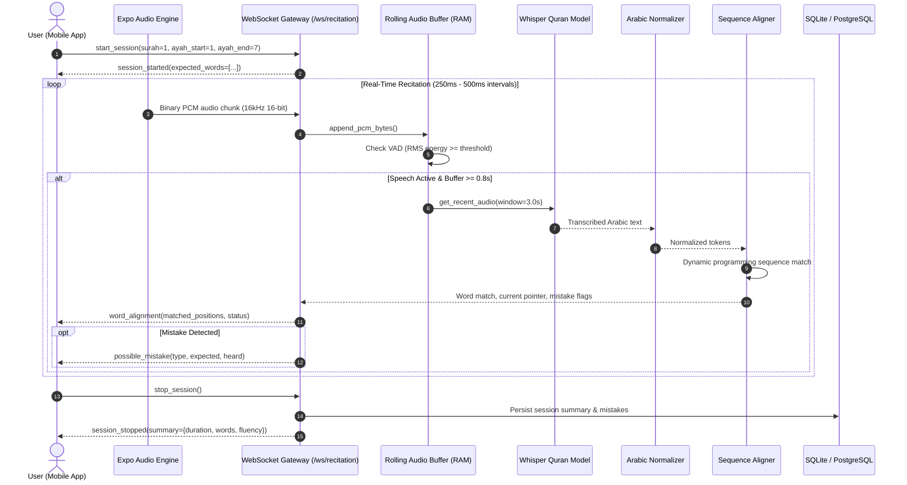

# Quran Companion AI — System Architecture & Engineering Blueprint

## 1. High-Level Architecture Overview
Quran Companion AI is an open-architecture, real-time Quran recitation, word-alignment, and memorization assistance system inspired by Tarteel AI. The platform consists of two principal tiers:

1. **Client Tier (Mobile)**: Built with React Native, Expo, and TypeScript. Provides native microphone capture via `expo-av`, audio metering, real-time WebSocket communication, Right-to-Left (RTL) Arabic typography, dynamic word highlighting, and Hifz memorization masking.
2. **Server Tier (AI & API)**: Built with FastAPI, Uvicorn, SQLAlchemy 2.x, PyTorch, and Hugging Face Transformers. Implements streaming audio buffering, energy-based Voice Activity Detection (VAD), chunked ASR inference with a Quran-adapted Whisper model, an Arabic orthographic normalizer, and sequence-based word alignment with mistake detection.

---

## 2. End-to-End Real-Time Recitation Pipeline

---

## 3. Speech Recognition & Rolling Buffer Strategy
Standard Whisper models operate on fixed 30-second windows. To achieve responsive 1-2 second live recitation tracking without excessive latency:
- Audio is ingested in continuous 250-500ms chunks and converted to 32-bit floating point normalized arrays.
- A rolling RAM buffer retains the most recent 3.0 seconds of audio.
- Fast Root-Mean-Square (RMS) energy thresholding filters out background silence so model inference only executes when speech is detected.
- Decoded tokens are normalized and fed into the sequence aligner.

---

## 4. Arabic Normalization & Text Alignment Engine

### Arabic Normalization Rules
Quranic Arabic contains extensive diacritics and complex calligraphy symbols that do not affect the base lexical words:
1. **Diacritics Removal (Harakat)**: Fatha, Kasra, Damma, Sukun, Shaddah, Tanween, and Dagger Alif are stripped for phonetic comparison while preserving the displayed Uthmani text.
2. **Quranic Symbols Stripping**: Recitation pause marks (`ۖ`, `ۗ`, `ۚ`, `ۛ`, `ۜ`, `۞`, etc.) are removed.
3. **Alif Normalization**: `[أ, إ, آ, ٱ]` are unified to standard `ا`.
4. **Letter Standardizations**: `ى` $\rightarrow$ `ي`, `ة` $\rightarrow$ `ه`.

### Word Alignment Classification
- **Matched**: Spoken token matches expected Quranic word (similarity $\ge 0.75$).
- **Omission**: Expected word was skipped by the reciter, and the subsequent word matched.
- **Substitution**: A different word was recited in place of the expected word.
- **Repetition**: The reciter repeated a previously recited word or phrase.
- **Insertion**: An extraneous word was detected.

---

## 5. Security & Privacy Architecture
- **Zero Raw Audio Retention by Default**: Recitation audio is processed in volatile memory (RAM) rolling buffers and immediately discarded after transcription.
- **Opt-in Audio Snippets**: Users can enable audio snippet retention in Settings strictly for personal mistake review.
- **JWT Authentication**: Passwords hashed with bcrypt; access tokens issued via HMAC-SHA256.
- **CORS & Rate Limiting**: Production protections against unauthorized streaming connections.
